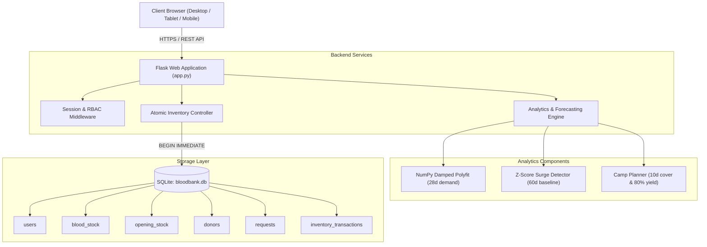

# LifeLink: An Intelligent Blood Donation and Emergency Response System

**LifeLink** is a full-stack, data-driven blood bank inventory management and emergency response platform built using Python (Flask), SQLite, Pandas, NumPy, and Chart.js. It is designed to assist blood transfusion centers, hospitals, and voluntary donor networks in preventing critical stockouts through mathematical demand forecasting, donor mobilization, and auditable emergency request fulfillment.

> **Academic Notice**: LifeLink was developed as a Final-Year B.Tech Computer Science and Engineering project. All donor profiles, transactions, and historical records provided in the repository are synthetically generated for demonstration and evaluation. The forecasting algorithms are deterministic mathematical projections and do not constitute clinical advice.

---

## Table of Contents
1. [Problem Statement](#1-problem-statement)
2. [Project Objectives](#2-project-objectives)
3. [Key Features](#3-key-features)
4. [Technology Stack](#4-technology-stack)
5. [System Architecture & Data Flow](#5-system-architecture--data-flow)
6. [Forecasting & Analytics Methodology](#6-forecasting--analytics-methodology)
7. [Project Directory Structure](#7-project-directory-structure)
8. [Prerequisites & Local Installation](#8-prerequisites--local-installation)
9. [Database Initialization & Demo Data](#9-database-initialization--demo-data)
10. [Running the Application](#10-running-the-application)
11. [Default Evaluation Accounts](#11-default-evaluation-accounts)
12. [API Reference](#12-api-reference)
13. [Automated Testing](#13-automated-testing)
14. [Deployment on Render](#14-deployment-on-render)
15. [Known Limitations & Future Scope](#15-known-limitations--future-scope)

---

## 1. Problem Statement

Blood banks and trauma centers frequently encounter severe operational challenges:
- **Asymmetric Supply & Demand**: Red blood cells have a finite shelf life (35–42 days). Shortages occur abruptly during regional health surges (e.g., dengue outbreaks, seasonal accidents), while over-collection leads to preventable expiration wastage.
- **Fragility of Rare Phenotypes**: Rh-negative blood groups (O-, A-, B-, AB-) account for less than 5% of the regional donor base, making unplanned stockouts particularly life-threatening.
- **Lack of Forward Visibility**: Traditional blood bank registries record historical entries in silos without forward-looking indicators of when specific blood groups will exhaust reserves.
- **Uncontrolled Request Allocation**: Unmanaged concurrent requests can result in double-allocation or negative inventory balances.

---

## 2. Project Objectives

- **Centralize Real-Time Inventory**: Track available units across all 8 major human blood groups (A+, A-, B+, B-, AB+, AB-, O+, O-).
- **Automate Shortage Forecasting**: Provide 14-day forward-looking inventory projections based on historical demand trends and rolling donation rates.
- **Detect Abnormal Demand Surges**: Flag statistical anomalies in hospital requests using standard deviation z-scores.
- **Optimize Donation Camp Planning**: Calculate exact unit deficits to reach a 10-day buffer and recommend targeted donor invite numbers accounting for an 80% medical screening yield.
- **Enforce Secure Triage & RBAC**: Isolate privileges across **Administrators**, **Donors**, and **Requesters** with secure password hashing, role-based session access, and masked donor privacy.
- **Atomic Inventory Integrity**: Guarantee that blood fulfillment decrements stock atomically within SQLite transactions, preventing negative stock.

---

## 3. Key Features

### Role-Based Access Control (RBAC)
- **Administrator**:
  - Full operational dashboard with real-time KPIs and 30-day expiry loss metrics.
  - Approve, reject, or fulfill hospital blood requisitions.
  - Record donor collections, direct hospital issuances, and expired unit write-offs.
  - Unmasked donor contact directory with telephone call actions.
  - Immutable audit trail (`inventory_transactions`) tracking all stock movements.
  - Protected database reset utility for academic demonstration.
- **Voluntary Donor**:
  - Self-registration with blood group, locality, gender, and contact details.
  - Profile management to toggle availability status (`Available` vs `Paused/Deferred`).
  - Rest-interval tracking (90 days for males, 120 days for females).
- **Healthcare Requester**:
  - Emergency blood requisition form with urgency prioritization (`Normal`, `Urgent`, `Emergency`).
  - Track requisition status through the standard lifecycle: `Pending` &rarr; `Approved` &rarr; `Fulfilled`.

### Data Analytics & Visualizations
- **Interactive Bag Fill Gauges**: Custom SVG blood bags whose liquid fill dynamically illustrates days of operational coverage (full bag = 21+ days).
- **Dual Chart.js Visualizations**:
  - Trajectory graph comparing 30 days of actual inventory with 14 days of projected reserves.
  - Flow bar chart comparing daily historical donations against hospital issues.
- **Expiry & Wastage Tracking**: Transparent table tracking 30-day discard volumes and loss percentages by blood group.
- **Donor Privacy Protection**: Contact numbers are automatically masked (`98******12`) for unauthenticated visitors, preventing public scrapers from harvesting donor telephone numbers.

---

## 4. Technology Stack

- **Backend**: Python 3.12+, Flask 3.1.3, Werkzeug Security (PBKDF2-SHA256 password hashing)
- **Database**: SQLite 3 with parameterized queries and atomic transaction locking (`BEGIN IMMEDIATE`)
- **Data Science & Modeling**: Pandas 2.2+, NumPy 2.1+
- **Frontend**: HTML5, CSS3 (Custom CSS Properties, responsive grid/flexbox), Vanilla JavaScript (ES6+ async/fetch)
- **Visualization**: Chart.js 4.4+ (UMD)
- **Production Server**: Gunicorn 23.0+
- **Deployment**: Render Blueprint (`render.yaml`)

---

## 5. System Architecture & Data Flow



---

## 6. Forecasting & Analytics Methodology

### A. 14-Day Demand Projection
- Hospital demand is modeled using a **first-order polynomial regression (NumPy `polyfit`)** on the preceding 28 days of issuance logs.
- The slope is conservatively damped (capped at $\pm 15\%$ of baseline) to avoid explosive trend extrapolation.
- The forward daily demand $\hat{D}_t$ is computed as:
  $$\hat{D}_t = \max\left(0, \text{Level} + 0.3 \cdot \text{Slope} \cdot t\right), \quad t \in [1, 14]$$

### B. Inflow & Expiration Assumptions
- Future donations $\hat{C}_t$ are modeled as the rolling mean of collections over the last 14 days.
- Future expirations $\hat{E}_t$ are estimated using the moving average of discards over the last 28 days.
- Future cumulative reserve $S_t$ is projected sequentially from current stock $S_0$:
  $$S_t = \max\left(0, S_0 + \sum_{i=1}^t (\hat{C}_i - \hat{D}_i - \hat{E}_i)\right)$$

### C. Demand Surge Anomaly Detection (Z-Score)
- Computes the mean issuance of the last 3 days against the 60-day baseline preceding them:
  $$z = \frac{\bar{x}_{\text{recent}} - \mu_{\text{baseline}}}{\sigma_{\text{baseline}} / \sqrt{3}}$$
- If $z \ge 2.0$, a high-priority warning is raised indicating a statistically significant demand surge.

### D. Camp Planning Logic
- Target safety stock is set at 10 days of average daily demand: $\text{Target} = 10 \times \text{Daily Demand}$.
- Deficit is calculated as: $\text{Gap} = \max(0, \lceil \text{Target} - \text{Stock} \rceil)$.
- Because donor deferral rates average 20% during standard physical triage, donor invitations are calculated using an 80% yield factor:
  $$\text{Donors to Invite} = \left\lceil \frac{\text{Gap}}{0.80} \right\rceil$$

---

## 7. Project Directory Structure

```
LifeLink/
├── app.py                  # Core Flask backend, RBAC routes, APIs, and database migrations
├── generate_data.py        # Generates realistic synthetic datasets aligned to calendar dates
├── requirements.txt        # Production Python dependencies
├── render.yaml             # Render infrastructure-as-code deployment blueprint
├── test_lifelink.py        # Comprehensive 18-step automated test suite
├── README.md               # Complete academic documentation
├── .gitignore              # Ignores runtime databases, caches, and virtual environments
├── data/                   # Baseline synthetic CSV datasets
│   ├── donors.csv          # 400 synthetic voluntary donors with areas and last donation dates
│   ├── opening_stock.csv   # Initial opening units for all 8 blood groups
│   ├── requests.csv        # 60 historical hospital requisition logs
│   └── stock_log.csv       # 365 days of historical daily donation, issue, and expiry records
├── static/
│   ├── script.js           # Client-side routing, Chart.js integrations, and AJAX handlers
│   └── style.css           # LifeLink Healthcare Design System (Crimson & Slate theme)
└── templates/
    ├── base.html           # Master layout with responsive navbar, user badge, and footer
    ├── dashboard.html      # Overview dashboard with KPI cards, bags, and wastage tracking
    ├── forecast.html       # 14-day projection line chart and 30-day flow bar chart
    ├── requests.html       # Hospital requisition submission and status workflow management
    ├── alerts.html         # Shortage, demand spike, and surplus redistribution alerts
    ├── camp.html           # Blood donation camp prioritization and donor invite targets
    ├── donors.html         # Donor directory with group/area filtering and privacy masking
    ├── log.html            # Authorized ledger for collections, issues, and audit trails
    ├── login.html          # Authentication login with quick-fill demo buttons
    ├── register.html       # Registration for voluntary donors and healthcare requesters
    └── profile.html        # Donor profile and availability settings management
```

---

## 8. Prerequisites & Local Installation

### Prerequisites
- Python 3.10, 3.11, or 3.12
- Git
- Web browser (Chrome, Firefox, Safari, Edge)

### Step-by-Step Setup

1. **Clone or navigate to the repository directory**:
   ```bash
   cd c:\Users\Asus\Desktop\LifeLink
   ```

2. **Create and activate a virtual environment**:
   - On Windows:
     ```powershell
     python -m venv .venv
     .venv\Scripts\activate
     ```
   - On macOS/Linux:
     ```bash
     python3 -m venv .venv
     source .venv/bin/activate
     ```

3. **Install required dependencies**:
   ```bash
   pip install -r requirements.txt
   ```

---

## 9. Database Initialization & Demo Data

On first startup, LifeLink automatically:
1. Creates the SQLite database file `bloodbank.db`.
2. Applies necessary schema definitions (`users`, `blood_stock`, `opening_stock`, `donors`, `requests`, `inventory_transactions`).
3. Shifts historical dates from `data/*.csv` so that the timeline naturally concludes on **yesterday**, ensuring real-time relevance.
4. Seeds the default demonstration accounts.

To manually regenerate synthetic datasets at any time:
```bash
python generate_data.py
```
*(You can then click "Restore Academic Demo Datasets" in the Inventory Log page as an Administrator, or delete `bloodbank.db` to re-seed from scratch).*

---

## 10. Running the Application

### Development Server
```bash
python app.py
```
Open your web browser and navigate to:
```
http://127.0.0.1:5000
```

### Production Mode (Gunicorn)
```bash
gunicorn app:app --workers 1 --bind 0.0.0.0:5000
```

---

## 11. Default Evaluation Accounts

For academic examination and grading, the following pre-configured accounts are seeded automatically:

| Role | Username | Password | Email | Intended Permissions |
| :--- | :--- | :--- | :--- | :--- |
| **Administrator** | `admin` | `admin123` | `admin@lifelink.org` | Full control: fulfill requests, view unmasked donors, log inventory, reset data. |
| **Voluntary Donor** | `donor1` | `donor123` | `donor1@lifelink.org` | Manage personal donor profile, update availability, view rest days. |
| **Requester** | `requester1` | `requester123` | `requester1@lifelink.org` | Submit hospital blood requests, view live requisition status. |

*(The sign-in page includes one-click quick-fill buttons for each role).*

---

## 12. API Reference

### Public & Authenticated Endpoints

| Method | Endpoint | Access Level | Description |
| :--- | :--- | :--- | :--- |
| `GET` | `/api/me` | Public | Returns current session status and role payload. |
| `GET` | `/api/overview` | Public | Full operational summary: KPIs, groups, alerts, camp targets, wastage. |
| `GET` | `/api/forecast/<grp>` | Public | 30-day history and 14-day projection series for a specific blood group. |
| `GET` | `/api/donors` | Public / Admin | Filter donors by `group`, `area`, `search`. Contacts masked unless Admin. |
| `GET` | `/api/areas` | Public | Distinct list of donor localities for filter dropdowns. |
| `GET` | `/api/requests` | Requester / Admin | List blood requisitions (requesters see own; admins see all). |
| `POST` | `/api/requests` | Requester / Admin | Submit a blood requisition (`hospital`, `blood_group`, `units`, `urgency`). |
| `POST` | `/api/requests/<id>/status` | Administrator | Update status (`Approved`, `Fulfilled`, `Rejected`). Atomically decrements stock on `Fulfilled`. |
| `POST` | `/api/donation` | Donor / Admin | Record collected donor units into inventory. |
| `POST` | `/api/request` | Public / Admin | Direct hospital issue endpoint (triaged according to role). |
| `POST` | `/api/expiry` | Administrator | Decommission expired blood units and record audit ledger entry. |
| `GET` | `/api/transactions` | Administrator | Retrieve the last 30 inventory audit records. |
| `POST` | `/api/reset` | Administrator | Restore baseline academic demo datasets. |

---

## 13. Automated Testing

LifeLink includes a built-in automated test suite (`test_lifelink.py`) validating all 18 core requirements:

```bash
python test_lifelink.py
```

### Verified Test Criteria
1. Application startup and HTTP 200 responses on all primary routes.
2. SQLite schema creation and table migrations.
3. User login, credential verification, and logout handling.
4. Role-based access control protecting restricted endpoints.
5. Donor registration and profile updating.
6. Multi-parameter donor filtering (group, area, search).
7. Blood requisition lifecycle initialization (`Pending`).
8. Input validation rejecting out-of-range units ($1 \le \text{units} \le 50$) or invalid blood groups.
9. Atomic calculation of instantaneous inventory reserves.
10. Prevention of negative inventory balances.
11. Multi-state request transitions (`Pending` &rarr; `Approved` &rarr; `Fulfilled`).
12. 14-day forecast payload generation and mathematical consistency.
13. Integrity of dashboard KPI arithmetic across blood groups.
14. Alignment of historical and forecasted Chart.js data arrays.
15. Resilient error handling for invalid or missing parameters.
16. Privacy protection masking donor phone numbers for unauthenticated visitors.
17. Enforcement of administrative-only authorization on data reset.
18. Production configuration (debug mode disabled by default, secure session flags).

---

## 14. Deployment on Render

LifeLink is pre-configured for automated deployment on **Render** via `render.yaml`.

### Deployment Steps
1. Push this project folder to your GitHub repository.
2. Log in to [Render](https://dashboard.render.com).
3. Click **New +** &rarr; **Blueprint** and connect your GitHub repository.
4. Render will parse `render.yaml` and configure the web service automatically:
   - **Environment**: Python 3.12
   - **Build Command**: `pip install -r requirements.txt`
   - **Start Command**: `gunicorn app:app --workers 1 --bind 0.0.0.0:$PORT`
5. Click **Apply**. Once built, the web application will be live at `https://<your-service>.onrender.com`.

### Persistent Storage Note for SQLite on Render
- Render's **Free Tier** uses an ephemeral disk. When the web service spins down or restarts, SQLite is cleanly re-seeded from `data/*.csv` automatically.
- For **Production Persistence**, attach a Render Persistent Disk mounted at `/var/data` and configure the environment variable:
  ```
  DB_PATH=/var/data/bloodbank.db
  ```
  `app.py` automatically checks for and creates parent directories if they do not exist.

---

## 15. Known Limitations & Future Scope

### Known Limitations
- **Synthetic Datasets**: Donor names, telephone numbers, and addresses are synthetically generated for academic demonstration.
- **Rule-Based Interval Screening**: Donor eligibility rests on elapsed time (90/120 days) and recorded availability; it cannot substitute for in-person medical vitals, hemoglobin tests, or infectious disease screening.
- **Single-Facility Perspective**: The current release models inventory for a centralized regional facility rather than a distributed multi-hospital drone logistics mesh.

### Future Scope
- **SMS / WhatsApp Gateway**: Integration with Twilio or WhatsApp Business API to trigger automated recall messages to eligible donors during critical shortage alerts.
- **Biometric Donor Verification**: Integration with Aadhaar / National Health ID cards for tamper-proof donation interval verification.
- **GIS Route Optimization**: GPS mapping for mobile blood donation van routing and hospital emergency dispatch.

---

## Academic Evaluation Summary

- **Course**: B.Tech Computer Science & Engineering (Final Year Project)
- **Project Title**: LifeLink — An Intelligent Blood Donation and Emergency Response System
- **Core Specialization**: Full-Stack Web Development, Time-Series Inventory Analytics, Applied Software Security
